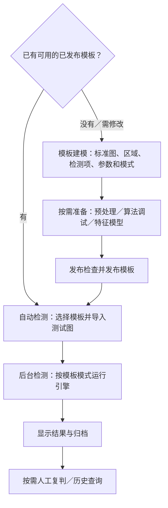
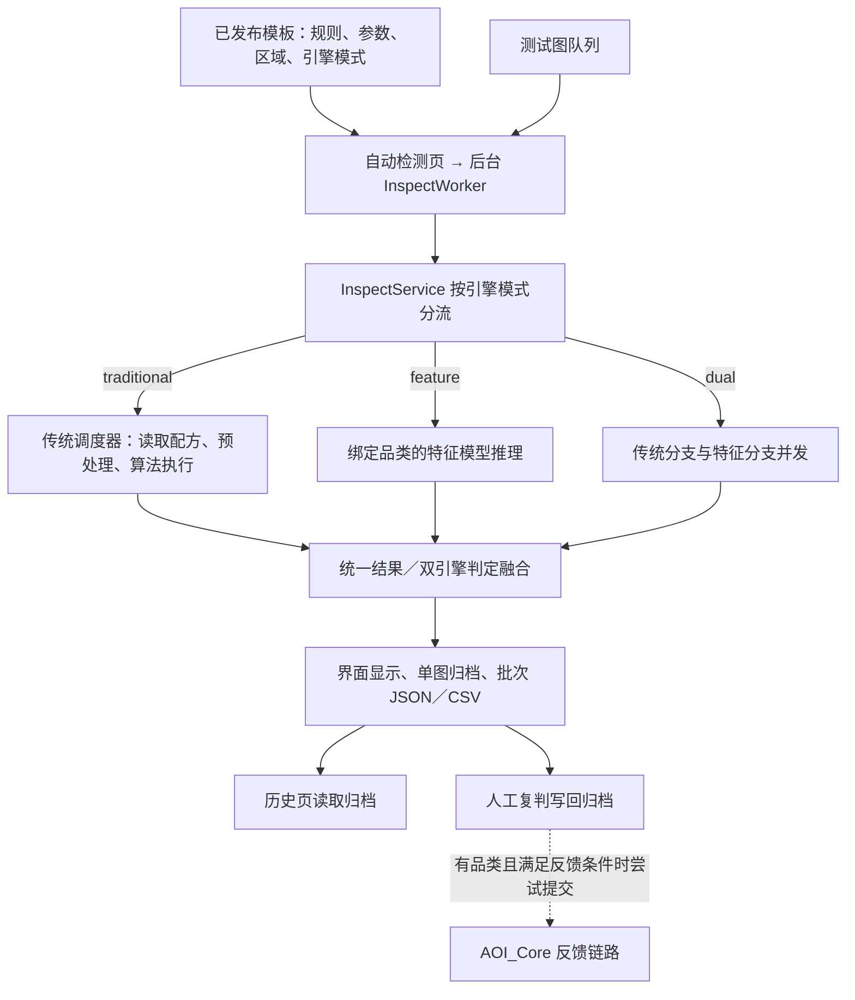

# PCB Dual 前端问题解答

依据《想法_UI.md》中 PCBDUAL 部分逐题记录。以实际代码为准，区分已实现功能、配置前提和业务边界，不把页面名称或设计愿景当作已完成的闭环。

## 1. 标题、状态栏和“设置／模板”菜单能否合为一行？

**可以，已修改应用内布局。**

原布局分别占用了菜单栏、应用标题区和底部状态栏。现在合并为一条应用顶栏：

> PCB 缺陷检测系统 ｜ 设置 ｜ 模板 ｜ 当前模板、检测进度、直通率 ｜ 状态提示

### 1.1 已完成的改动

- “设置”和“模板”菜单嵌入应用标题区，原菜单操作保留。
- 隐藏独立底部状态栏，将其消息转发到顶部右侧，包括加载失败和算法适配器警告。
- 空间不足时省略长文本，鼠标悬停可查看完整内容；缩放窗口时重新计算显示文本。
- 页面名称不再在顶栏单独重复占位，标签页仍用于页面导航。
- 保留 Windows 原生标题栏，避免引入无边框窗口的拖动、缩放、最大化和系统菜单兼容问题。因此“合为一行”针对应用内部区域，不包括操作系统标题栏。

修改文件：`app/ui/main_window.py`。

### 1.2 验证范围

上一问实际执行了 Python 编译检查，以及 1100 像素宽度下的 Qt 离屏组件检查，检查菜单数量、状态消息转发、底部状态栏隐藏和顶栏高度，均通过。Git 差异检查最初将 CRLF 行尾报告为尾随空白，按 CRLF 行尾规则复查通过。

**尚未进行真实桌面多分辨率视觉验收，不据此声称所有显示比例都已验证。** 本题没有修改检测业务，也没有调整页面顺序。

## 1.3 右侧缺陷属性列表布局

此前这项问题**没有完成**：缺陷表虽然已有“原因 / 原始结果”列，但右侧区域宽度不足，窗口较窄时仍会出现水平滚动，列标题和内容也可能被截断。

本轮已调整：

- 增加自动检测页右侧结果区的初始宽度，并提高其横向伸缩权重。
- 压缩序号、位置、尺寸、ROI、状态等非关键列的默认宽度。
- 为“原因 / 原始结果”保留更宽的内容列。
- 缺陷表采用短列按内容自适应、关键文本列伸缩的布局；文本不使用省略号，较长原因可以换行，完整内容仍可通过悬停提示查看。
- 常规布局关闭水平滚动，避免用户必须横向拖动才能看到属性；窗口过窄时通过换行和压缩列宽维持可见性。

修改文件：`app/ui/inspect_page.py`、`app/ui/defect_table.py`。

边界：在 1100 像素等极窄窗口下，十列属性不可能全部同时保持足够阅读宽度；当前不会出现水平滚动，但部分字段会变得拥挤、行高增加。建议正常使用宽度不低于 1400 像素。

## 2. 历史页面有什么意义？左侧列表如何避免水平滚动？

### 2.1 页面意义和用户价值

历史页不是再次执行检测的页面，而是正式检测结果的归档查询和追溯入口。它把自动检测产生的 `result.json` 按时间、模板、图号和判定集中列出，用户可以：

- 筛选 `OK`、`NG`、`GRAY`、`ERROR` 和已经复判的记录；
- 按模板或关键字定位某一张测试图；
- 选中记录后查看结果 HUD、检测图、缺陷框和算法明细；
- 查看人工复判结果，打开该记录目录，或删除不需要的归档；
- 通过当班直通率和 Top 缺陷获得当前加载记录的快速概览。

因此它提供的是复盘、追责、问题定位和结果留痕价值：自动检测页回答“刚刚检测结果是什么”，历史页回答“之前检测过什么、当时使用了哪个模板版本、具体哪里异常”。默认隐藏调试/试跑记录，避免把试验结果混入正式质量记录；只有算法调试显式选择归档时才会进入历史。

需要注意：历史页不是数据库级无限审计查询，当前单次最多加载最近 1000 条归档；读不到可视化文件时会尝试读取测试图，并不保证所有历史记录都能恢复原始图片，因为归档保存的是输入图路径，不是原图副本。

### 2.2 左侧列表布局调整

此前历史表格的列宽主要依赖最后一列拉伸，时间、模板名、图号和 NG 摘要较长时会导致水平滚动或文字截断。本轮已将历史列表改为：

- 时间、判定、复判、耗时等短字段按内容自适应；
- 模板、图号、NG 摘要等字段分配剩余空间并允许换行；
- 禁用省略号和常规水平滚动，优先让所有列同时可见；
- 选中记录后的详细缺陷内容仍在右侧缺陷表中显示，长字段可通过换行和 tooltip 查看。

修改文件：`app/ui/history_page.py`。

边界：极窄窗口下列表会通过换行增加行高，不能保证每列都保持宽松阅读空间；建议先放大窗口，而不是依赖横向滚动。右侧详情区域与左侧列表仍会通过分割器共同分配空间。

## 3. 模板建模页面：所谓建模是什么，完整流程如何进行？

这里的“建模”不是在此页面训练深度学习模型，而是以一张标准图为基准，建立 PCB 检测模板：把标准图、检测类别、检测项、检测区域、算法参数、引擎模式和品类模型绑定成可执行配置。

实际流程如下：

1. 点击“选择标准图新建”，系统以标准图创建独立模板；同一标准图已绑定模板时不能重复创建，遵循“一图一模板”。
2. 在右侧填写模板名称，选择 `traditional`、`feature` 或 `dual` 引擎模式；`feature`/`dual` 还需要绑定 AOI_Core 中可用的品类模型。
3. 选择一个检测类别，再勾选该类别下需要启用的检测项；当前实现限制一个模板绑定一个检测类别。
4. 在“区域”下拉框选择与检测项对应的标定层，在标准图上绘制矩形、圆形或点位。区域类型由 Catalog 和检测项决定，不是任意形状都适用于所有检测项。
5. 在检测参数区域调整算法参数；也可以按需使用“调参辅助”、预处理和算法调试验证输入与阈值。
6. 查看页面底部发布检查清单，处理阻断项；点击“试跑一张”只能做不归档的快速验证，不能代替正式双引擎验收。
7. 点击“保存模板”保存草稿，确认配置可以继续编辑；点击“发布”通过门禁后，模板状态变为 `published`，自动检测页才能选择它。
8. 已发布模板再次改参数时会升版本并回到草稿状态，必须重新发布后才会进入正式检测。

数据流是：标准图 → 模板配置/标定区域 → 参数冻结与发布检查 → 已发布模板 → 自动检测页读取并执行。这个页面的主要产物是模板配置，不是检测结果，也不是训练权重。

## 4. 保存模板和发布模板之后分别服务于哪个页面？

- **保存模板**服务于模板建模页自身的持续编辑，也让模板配置、区域和参数可以被重新加载；保存后的状态是草稿，正式自动检测的模板选择器默认只列出已发布模板。
- **发布模板**服务于自动检测页和正式检测服务。发布通过检查后，状态变为 `published`，自动检测页才能选择；正式检测据此读取标准图、区域、检测项、参数、引擎模式和品类绑定。
- 发布后进入自动检测页只是页面跳转便利，不代表已经执行检测；模板发布也不等于特征模型训练、模型激活或预处理配方永久冻结。
- 历史页不直接读取草稿，而是读取正式检测产生的归档结果，并从结果中保留模板 ID、版本和规则快照用于追溯。

## 5. “区域”下拉选项右边的矩形/圆形选择是为了什么？

“区域”下拉框先选择当前正在编辑的标定层，例如本体重点区域、插件锡面/焊点、贴片焊盘、toe、rim、元件底座框或金手指取色点；右侧的矩形/圆形是绘制该层区域时使用的几何形状。

矩形适合规则的焊盘、元件框或长方形检测区域；圆形适合近似圆形或需要以中心和半径表达的区域。绘制结果会写入当前模板的 `region_sets`，并同步旧版标定存储，之后由对应算法读取。金手指取色点属于点位标定，代码会禁用矩形/圆形按钮，避免把点位误画成区域。

这不是“选择检测算法”，也不是把所有算法都改成圆形检测；具体可用的区域层和形状仍由已勾选检测项决定。

## 6. 检测项和参数设置如何调整？

此前所有已勾选检测项的参数会连续堆叠在页面下方，检测项较多时不便定位。本轮将检测项操作拆成两个明确动作：

- **勾选框**：决定该检测项是否写入模板并在正式检测中启用；不勾选就不会参与检测。
- **“参数”选中按钮**：只决定当前正在查看和编辑哪一个已勾选检测项的参数，不改变启用状态。选中某项后，参数区只显示该项及其关联的共用参数，避免多个检测项的参数同时堆在右下角。

如果点击未勾选项的“参数”，页面会提示先勾选；勾选状态改变后，若当前参数项已被取消勾选，参数区会自动切换到剩余的第一个已启用检测项。参数保存仍沿用原有模板专用/算法默认层级，未改变检测配置的存储方式。

因此，当前页面已经实现“勾选负责启用、选中负责查看参数”的区分；它解决的是参数浏览和编辑的布局问题，不代表不同检测项可以跨类别混合绑定，一个模板仍只能绑定一个检测类别。

修改文件：`app/ui/template_studio_page.py`。

## 7. 特征学习页面为什么和 AOI_Core UI 不完全一致？

### 7.1 当前实际接入方式

PCB Dual 的“特征学习（AOI_Core）”并不是重新实现了一套特征学习算法，也不是复制一份 AOI_Core 页面。当前 `CoreHubPage` 会在首次进入该页时：

1. 检查 AOI_Core 服务是否健康；
2. 通过 `aoi_core_dir` 动态加载 AOI_Core 的 `ui.pages.*` 页面类；
3. 通过 `ApiClient` 调用 AOI_Core 后端，并启动 AOI_Core 的任务监控；
4. 使用 AOI_Core 自己的页面实现、接口、任务和主题样式；
5. 在 PCB Dual 外层增加品类下拉框和左侧页面导航，把数据管理、数据增强、模型管理、评估、复核、学习、特征工程和统计组织在一个 Tab 内。

所以实际情况是：**核心页面已经直接复用 AOI_Core 前端页面，外层容器不是 AOI_Core 原生主窗口。** 看起来不一致的部分主要来自 PCB Dual 的应用顶栏、Tab、左侧导航、品类选择器和容器布局；Core 页面的 QSS 只作用于该 Tab 子树，没有覆盖 PCB Dual 的全局主题。

### 7.2 能否完全改为 AOI_Core 原生前端？

可以，但需要明确代价。当前实现选择的是“同进程嵌入真实 Core Qt 页面”的方案，而不是启动第二个 AOI_Core 主窗口或用浏览器套一层。若完全改成 AOI_Core 原生主窗口，会带来两个窗口、状态同步、页面跳转和 PCB 模板上下文传递问题，反而不利于双引擎工作流。

更合理的改进方向不是复制页面，而是让嵌入容器尽量使用同一套 Core 导航和视觉规范：统一导航宽度、间距、标题层级、颜色和状态提示，同时保留 PCB Dual 的外层容器。这样既保持 AOI_Core 页面实现唯一，又避免两套前端逐渐漂移。

本轮已在 `app/ui/core_pages.py` 完成最小外壳优化：统一浅灰背景、外边距、176 像素侧栏，复用 Core 的 `nav` 导航样式，并统一标题和品类控件样式。未修改 AOI_Core 页面内部或算法接入方式；真实后端、模型、反馈和学习状态仍然是唯一来源。完整视觉一致性仍需真实桌面验收。

## 8. 直接接入 AOI_Core 后，PCB Dual 如何实现双引擎检测？

“页面直接接入 AOI_Core”和“双引擎一次检测同时运行”是两个不同层次的问题：前者是 UI 与服务接入，后者是检测服务编排。特征学习页面负责管理品类模型、评估、反馈和学习状态，不负责在界面层串行调用传统算法。

正式自动检测使用模板的 `engine_mode`：

- `traditional`：只执行 PCB Dual 传统模板算法；
- `feature`：只通过 `FeatureClient` HTTP 调用 AOI_Core 特征推理；
- `dual`：同一张测试图同时提交给两个分支。

在 `dual` 模式下，PCB Dual 的 `InspectService.run_dual()` 使用 `ThreadPoolExecutor(max_workers=2)`：

```text
同一张测试图
   ├─ 传统引擎：标准图 + 模板区域 + 传统算法调度器
   └─ 特征引擎：FeatureClient → AOI_Core HTTP 推理
                  ↓
             两个 future 返回
                  ↓
             fuse_dual() 统一融合
                  ↓
             总体判定 + 双引擎明细 + 缺陷框
```

两个分支是任务级并发，不是先传统后特征的串行流程。传统分支返回逐检测项结果，特征分支返回 score、decision、slot_scores、热图、缺陷框和 AOI_Core detection_id；两份结果会原样保留在 `dual_json` 中，供自动检测展示、历史追溯和人工复核。

融合规则不是把两个分数简单平均：

1. 必需引擎缺失或任一引擎执行错误 → `ERROR`；
2. 任一引擎判定缺陷 → `NG`；
3. 没有 NG，但传统引擎要求复核 → `REVIEW`；
4. 没有 NG，但特征引擎处于灰区 → `GRAY`；
5. 两个引擎均正常 → `OK`。

缺陷框会按跨引擎 IoU 去重；无法合并的框分别保留来源，合并后的框保留 `traditional`、`feature` 或 `dual` 来源信息。因此双引擎的价值是同一张图得到两套独立证据并进行可追溯汇总，而不是把 AOI_Core 页面嵌入后就自动产生双检。

需要特别区分：建模页的“试跑一张”和算法调试页仍主要走传统调度路径，不能用来证明 `dual` 模式已经完成正式双引擎验收；正式自动检测和后台管线才使用完整的 `run_dual()` 编排。

## 9. 整个 PCB 检测系统的工作流程是什么？先哪个页面，后哪个页面？数据流是什么样？

### 9.1 不需要按标签页从左到右操作

目前页面排列为：

> 算法调试 → 预处理 → 自动检测 → 历史 → 模板建模 → 特征学习（AOI_Core）

这只是导航排列，不是强制操作流程。

**首次配置一种 PCB：**

1. 在“模板建模”选择标准图，配置检测项、区域、算法参数和引擎模式。
2. 按需使用“预处理”和“算法调试”，反复验证传统算法输入和参数。这两页不是所有检测都必经的步骤。
3. 若使用 `feature` 或 `dual`，在“特征学习（AOI_Core）”准备好绑定品类的可用模型；已有可用模型则不必重复准备。
4. 回到“模板建模”执行发布检查并发布模板。
5. 进入“自动检测”，选择已发布模板，导入测试图，执行单张或批量检测。
6. 查看检测结果，按需人工复判；在“历史”查询已归档结果。

第 2、3 步是按模式需要完成的配置工作，并非必须严格先后执行。

**已经有可用的已发布模板：**

> 自动检测：选择模板 → 导入测试图 → 开始检测 → 查看／复判 → 历史查询

不需要每次重新建模、训练、调参或保存预处理。

### 9.2 各页面的角色

| 页面 | 什么时候使用 | 实际产物／作用 |
|---|---|---|
| 模板建模 | 首次配置或修改检测方案 | 标准图引用、区域、检测项、冻结算法参数、引擎模式、品类绑定和模板版本 |
| 预处理 | 传统算法需要调整输入时，可选 | 预览图像变换，保存预处理配方；不是正式结果归档 |
| 算法调试 | 传统算法需要试验和调参时，可选 | 调试结果；默认不归档，可勾选“归档本次” |
| 特征学习（AOI_Core） | 准备、评估、治理特征模型时 | 按品类管理数据、模型、评估、复核和学习；不是进入页面就自动开启双引擎 |
| 自动检测 | 正式检测入口 | 单张检测结果、批次汇总、可视化和复判信息 |
| 历史 | 检测后查询，可选 | 读取既有归档，筛选、查看详情、打开目录或删除记录 |

AOI_Core 容器中的数据管理、数据增强、模型管理、评估、复核、学习等页面，也不是每次都必须依次走完的流水线。页面首次进入会检查 AOI_Core 后端是否健康。

### 9.3 操作流程图



### 9.4 真实检测数据流



核心调用链：

> 自动检测页 → `InspectWorker` → `run_batch_aware()` → 每张图的 `run_template_aware()` → 对应引擎 → 统一结果 → 归档／批次汇总。

单张检测也使用后台线程；批量检测当前逐张处理，不能把“双引擎并发”理解成“多张图片同时并发检测”。

### 9.5 保存模板与发布模板不是同一件事

- **保存草稿**：把当前模板配置写入存储，供后续编辑、标定和调参；正式自动检测不能使用草稿。
- **发布模板**：执行发布检查，成功后标记为 `published`，正式自动检测才能选择使用。发布操作本身会收集并保存配置，不要求先单独点击一次保存。
- 已发布模板在建模页保存修改时，会要求确认升版本，版本号增加并转为草稿，需要重新发布。
- 当前模板主文件为 `templates/<模板ID>/template.json`。版本号增加不代表每个版本都有独立的可回滚模板文件；检测归档另外保留版本和规则快照。
- 发布检查中，适配器未加载可能只是警告。因此“发布成功”不代表所有算法运行条件必然满足；正式检测关闭 stub，缺少适配器会报错，而不是用模拟结果放行。

### 9.6 预处理保存后，正式检测如何使用？

预处理页面保存的是配方 JSON，不是预处理后的图片。主要存储在 `storage/recipes/` 下。

传统调度器运行时读取配方，对标准图和测试图执行预处理，再交给算法；同一张图的相同配方可以复用缓存。

当前实际配方优先级：

> 类别＋算法 → 算法专属 → 类别默认 → 全局默认。

虽然部分注释描述为不再传类别，但模板检测服务实际仍传入模板类别。因此旧类别配方存在时仍可能命中，不能只看页面上的全局默认就认定其一定生效。

**这套配方链连接的是传统分支。** 特征分支直接调用模型图像推理接口，不先经过这个 `RecipeStore` 链路，模型有自己的输入处理。因此不能声称该页面的配方会同时改变双引擎的两个分支。

正式检测读取当前外部配方，发布模板也不等于将这些配方一起永久冻结。

### 9.7 双引擎实际如何工作？

| 模式 | 实际执行 |
|---|---|
| `traditional` | 只运行传统算法调度器 |
| `feature` | 只运行绑定品类的特征模型 |
| `dual` | 使用两个工作线程并发提交传统分支和特征分支，等待完成后融合判定 |

`feature`／`dual` 需要绑定品类并具备可用模型版本。品类优先使用 `model_category`，为空时回退 `category`；运行时还需要特征引擎能够访问并成功推理。

双引擎属于任务级并发，不保证耗时减半，也不能仅凭代码注释保证 CPU／GPU 始终完全独立。

当前融合是判定级规则，不是两个模型分数的加权概率：

1. 必需引擎缺失或执行错误 → `ERROR`。
2. 任一引擎判缺陷 → `NG`。
3. 无 NG，但传统分支需要复核 → `REVIEW`。
4. 无上述情况，但特征分支为灰区 → `GRAY`。
5. 两者正常 → `OK`。

**重要边界：建模页“试跑一张”直接调用传统模板执行路径，并允许 stub，不走完整的模式分流；算法调试页也走传统调度器。** 因此即使模板选择了 `dual`，这些调试结果也不能证明完整双引擎正式检测已通过验收。

### 9.8 结果在哪里，历史页读取什么？

输出根目录可通过设置修改，不是固定不可变的路径。当前配置指向 `storage/outputs`。

单图归档结构：

```text
<输出根目录>/<日期>/<时间_测试图名>/
  result.json
  result_vis.png（存在可视化图时）
```

主要保存时间、来源、模板 ID／版本和规则快照、输入图路径、总体判定、耗时、逐算法结果、缺陷框、错误信息和人工复判字段。

**保存输入图路径不等于复制保存原图。** 当前归档逻辑没有把标准原图和测试原图一起复制进去。

批次完成后另外保存 `batch_summary.json` 和 `batch_summary.csv`，记录模板信息、结果计数、取消状态及逐图摘要等。

历史页读取单图 `result.json`，默认最多加载 1000 条，默认隐藏 `debug`／`trial` 来源。算法调试只有勾选归档才写历史；建模试跑不归档。

不是所有失败尝试都必然生成单图目录：读图失败、模板准备失败、门禁阻断等可能提前返回；批次汇总仍可能记录这些失败项。

人工复判会先写回归档。具备品类且机器判定有效等条件满足时，还会尝试提交 AOI_Core 学习反馈；提交失败不会撤销已经落盘的复判，提交成功也不等于生产模型已经即时学习或激活。

### 9.9 本题核查依据与范围

主要核查文件：

- `app/ui/main_window.py`：页面装配、导航和顶栏。
- `app/ui/template_studio_page.py`、`app/template/store.py`：模板保存、发布、试跑和发布门禁。
- `app/ui/preprocess_page.py`、`app/recipe/store.py`：配方预览、保存和选择优先级。
- `app/ui/detect_page.py`、`app/detect/scheduler.py`：传统算法调试及检测时预处理。
- `app/ui/inspect_page.py`、`app/inspect/worker.py`、`app/inspect/service.py`：正式检测、后台任务、引擎分流和归档。
- `app/inspect/fusion.py`：双引擎融合规则。
- `app/ui/core_pages.py`：AOI_Core 页面接入。
- `app/result/store.py`、`app/ui/history_page.py`：结果落盘和历史读取。

本题已修改页面顺序和相关 UI 外壳，但没有修改检测融合规则或模型；没有执行真实图片前向、批量检测、模型发布或完整双引擎运行验收。

## 10. 按《想法_UI.md》逐条复核的完成状态

结论：**PCBDual 的问题已经逐条有业务解释，但并非全部完成了代码改进，也没有全部经过真实桌面验收。**“已回答”表示已核对真实代码并说明边界；“已改进”表示已有代码或界面调整；“未改进”表示目前只有解释，不能包装成已解决。

| 页面 / 原问题 | 当前状态 | 核查结论 |
| --- | --- | --- |
| PCBDual：标题、状态栏、设置和模板菜单合并 | 已改进 | 已合并到应用内部顶栏；保留操作系统标题栏；尚未完成全部分辨率人工验收。 |
| PCBDual：整体流程和数据流 | 已回答 | 已说明页面不是强制从左到右，补充模板、预处理、调试、AOI_Core、自动检测、历史和双引擎数据流。 |
| PCBDual：算法调试、预处理移到最左侧 | 已改进 | 已移到前两位；状态名称仍按页面对象的 indexOf 映射，页面跳转使用 setCurrentWidget，不依赖旧索引。 |
| 自动检测：功能和业务流程 | 已回答 | 已通过整体流程、`InspectWorker`、`InspectService`、引擎分流、结果归档和复判链路说明；页面内尚未增加专门流程引导。 |
| 自动检测：右侧缺陷表水平滚动和原因列截断 | 已改进，视觉待验收 | 已增大右侧区域、调整列宽、支持换行、关闭常规水平滚动并保留 tooltip；极窄窗口仍可能拥挤。 |
| 历史：页面意义和用户价值 | 已回答 | 已说明归档查询、质量追溯、复判查看、模板版本和结果留痕作用。 |
| 历史：左侧列表水平滚动 | 已改进，视觉待验收 | 已采用短列自适应、长列伸缩、换行和关闭常规水平滚动；极窄窗口可读性仍需人工确认。 |
| 模板建模：建模流程 | 已回答 | 已说明标准图、检测类别、检测项、区域、参数、引擎模式、试跑、保存和发布流程。 |
| 模板建模：保存和发布分别服务哪里 | 已回答 | 保存服务于草稿编辑；发布服务于自动检测和正式检测；历史页读取的是检测归档而不是草稿。 |
| 模板建模：矩形/圆形区域选择 | 已回答 | 已说明几何标定用途、不同检测项适用范围和点位标定限制。 |
| 模板建模：检测项参数堆叠、勾选和选中逻辑 | 已改进，运行待验收 | 已区分勾选启用和“参数”选中，参数区只显示当前检测项；尚未完成真实 Qt 交互验收。 |
| 模板建模：调参辅助具体作用 | 已回答 | 已在流程中说明其用于传统算法输入、阈值和参数验证；尚未新增更详细的页面内引导。 |
| 模板建模：调参辅助是否只针对部分检测项 | 已回答，未扩展改造 | 已记录其依赖检测项和标定能力，并说明不是所有检测项都需要抽色；复杂的按检测项能力提示尚未实现。 |
| 预处理：页面作用和效果 | 已回答 | 已说明预处理预览、配方保存、传统调度器读取和实际图像效果。 |
| 预处理：是否属于模板模块 | 已回答，存在边界 | 它是独立配方模块，会被传统分支按优先级读取；不等于模板内部冻结配置，也不会自动作用于特征分支。 |
| 算法调试：是什么、作用是什么 | 已回答，页面引导有限 | 已说明它是传统算法的试验和调参入口，默认不归档；尚未增加专门的页面说明卡片。 |
| 算法调试：标准图和侧视图框高度不一致 | 已改进，视觉待验收 | 实际为标准图与测试图/结果两列，无独立侧视图。两侧统一使用 InspectCanvas 的工具条与 Card 外壳、相同画布最小尺寸和等权横向布局，避免只有测试图顶部有工具条导致卡片错位。 |
| 算法调试：检测结果仍需水平滚动、原因列不完整 | 已确认复用并补充最小设置 | 直接复用 DefectTable 的短列自适应、长列伸缩、换行、禁用省略及水平滚动设置；调试页补充最小宽度和伸缩权重，极窄窗口仍可能拥挤。 |
| 特征学习：是否直接接入 AOI_Core、UI 为何不一致 | 接入已实现，外壳已改进 | 保留真实 Core 页面与主题，仅调整 CoreHubPage 外壳：背景、12/10 边距、176 像素侧栏、原生 nav 样式、标题及品类控件；未改 Core 页面内部，完整桌面视觉待验收。 |
| 特征学习：接入后如何实现双引擎 | 已回答，正式编排已实现 | `dual` 模式通过两个并发分支执行传统和 AOI_Core 特征推理，再统一融合并保留双侧结果；未完成真实图片双引擎验收。 |

### 10.1 当前仍未完成的 PCBDual 改进

1. 本轮已完成标签顺序、调试预览外壳、结果表复用核查及 CoreHubPage 最小外壳统一；未完成多分辨率和显示缩放比例下的真实桌面视觉验收。
2. 未完成自动检测、历史页、模板参数页的完整真实交互验收。
3. 未完成真实图片、模板发布、传统/特征/双引擎端到端运行验收。

本轮验证：三个修改的 UI 文件通过 `python -m py_compile`；编辑器诊断未返回问题；限定本轮四个修改文件的 `git diff --check`（按 CRLF 行尾规则）通过。未执行真实桌面多分辨率检查、AOI_Core 服务联调、真实图片检测及完整端到端验收。全仓差异检查受到其它既有文件的尾随空白影响，不代表本轮文件检查失败。

因此，不能说《想法_UI.md》中 PCBDual 的所有问题都已经改进；准确结论是：**全部问题已有逐条解释，本轮补齐最小 UI 缺口，仍有明确的视觉和运行验收缺口。**
